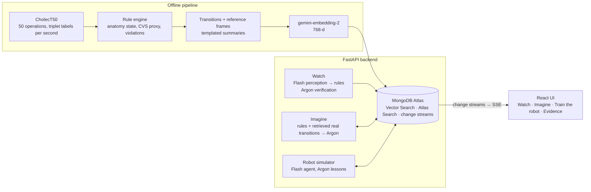

# Second Look

A patient world model for laparoscopic cholecystectomy. Second Look tracks the patient's anatomy state, predicts what each surgical action does to it, and scores whether a simulated robot acted safely. It is built on Gemini and MongoDB Atlas and grounded in real, labelled surgical video (CholecT50).

> **Research simulator, not a medical device.** Patients are synthetic. Nothing here is clinical advice.

Pixel world models (e.g. NVIDIA Cosmos-H) show what the camera would see. Second Look knows what is happening to the patient and whether the robot did the right thing.

## Eyes + imagination (combined with Igor's Second Look prototype)

- **Eyes** (Igor, `main` branch): Gemini Argon judges the critical view of safety directly from Endoscapes video, scored against three surgeons. His recorded runs are vendored in `demo/endoscapes/` and replayed as our perception (`backend/endoscapes.py`).
  - Op 166: CVS declared at 1:09 vs the surgeons' 1:04.
  - Op 198: never declared (fails safe).
- **Imagination** (this project): the patient world model plays the decision forward from what the eyes saw.
  - Op 166 at 1:00 (CVS not yet seen): "clip the duct now" is **high risk**, and an injury for a short-duct patient.
  - At 1:33 (CVS held): the same action is **low risk**.
- **Surgeons' judgement as evidence:** Igor's Atlas library of 3,437 surgeon-labelled frames is queried **read-only** (`backend/experts.py`, vector search only) to show how surgeons judged visually similar views.
- **UI:** a 3D patient model that builds itself from the state stream as the video plays, an overlay of the model's work on the video, a timeline comparing the model with the surgeons, a map of possible futures, robot trajectories, and a Story screen. Pixel world models (Igor's Wan 2.2 preview) show the camera; this shows the patient.

## How it works

- **Rule engine** (`backend/rules.py`): deterministic surgical facts.
  - A clipped duct stays clipped.
  - Cutting needs two clips.
  - Clipping needs the critical view of safety (CVS proxy).
  - These are the source of truth and of the safety reward.
- **World-model step** (`backend/world_model.py`):
  1. The rules apply the action.
  2. Atlas Vector Search retrieves the 5 most similar *real* transitions (train videos only, same phase).
  3. `gemini-4-argon` predicts risk, bleeding risk, explanation and likely next actions, citing those transitions.
  4. The rules have the final say on hard constraints.
  5. The closest real reference frame is attached and always labelled "closest real frame".
- **Atlas**: transitions, frames, sessions, world state, predictions and alerts all live there. The SSE stream is fed by Atlas change streams.

## Architecture



The rule engine has the final say on hard facts in every mode. The model cannot un-cut a structure or mark CVS met.

## Setup

### 1. Gemini API key (hackathon credits)
1. Redeem the credit code from the Google DeepMind booth onto a Google Cloud billing account.
2. Open [aistudio.google.com](https://aistudio.google.com) → **API keys** → **Create API key** → choose the Cloud project that holds the credits.
3. Check the key shows a **paid** tier, not "Free". Free-tier rate limits break parallel calls. Set a budget alert in Cloud Billing.
4. Copy `.env.example` to `.env` and set `GEMINI_API_KEY=...`.

### 2. MongoDB Atlas ($100 credit)
1. Open [cloud.mongodb.com](https://cloud.mongodb.com). Create an organisation, then go to **Billing** and apply the credit code *before* creating anything.
2. Create a project, then **Create cluster**. Choose **M10** (or **Flex** if M10's weekend cost is too high) on AWS eu-west-2. Do not use the free M0: it allows only 3 search indexes and we need 5. Write the hourly price in `DECISIONS.md`.
3. **Database Access**: add one database user with a password. **Network Access**: add your current IP, or `0.0.0.0/0` for the weekend only.
4. **Connect → Drivers → Python**: copy the `mongodb+srv://...` string into `.env` as `MONGODB_URI=...` (fill in the password), and set `DB_NAME=second_look`.
5. Pause or terminate the cluster after judging.

### 3. Install and run
```bash
uv venv .venv && uv pip install -r requirements.txt      # or: python -m venv .venv && pip install -r requirements.txt
source .venv/bin/activate
python -m backend.db --ping                               # Atlas reachable
python pipeline/01_download.py --images                   # labels for 50 videos + reference frames (≤5 GB)
python pipeline/02_build_states.py                        # per-second states; prints E4 sanity check
python pipeline/03_transitions.py                         # transitions + frame index
python pipeline/05_patients.py                            # synthetic patients -> Atlas
python pipeline/04_embed_load.py                          # embed + load Atlas + create indexes
python -m eval.live_acceptance                            # M0/M3/M4 acceptance checks
python -m eval.next_step_eval --split val --n 50          # prompt tuning (never on test)
python -m eval.next_step_eval --split test --n 200        # E1 + E2 headline number
python -m eval.perception_eval --n 200                    # E3 perception
python -m eval.agent_eval --patients P2 P4 --episodes 10  # E5 robot safety (biggest Gemini job)
python pipeline/06_image_embed.py                         # image embeddings for multimodal frame search
python pipeline/07_expert_views.py                        # cache "how surgeons judged similar views" (Igor's library, read-only)
python demo/record.py --mode live                         # record every demo path for the fallback
python demo/record_endoscapes.py                          # world-model steps from Endoscapes decision moments
uvicorn backend.api:app --reload                          # API on :8000 (docs at /docs)
```
`.env` also takes `EXPERT_MONGODB_URI` (Igor's expert library; a read-only Atlas user is best). Tests that need no credentials: `pytest`. Offline demo (no Wi-Fi, no keys): `DEMO_MODE=precomputed uvicorn backend.api:app`.

Frontend (Vite + React + Tailwind, `frontend/`):
```bash
cd frontend && npm install && npm run dev                 # http://localhost:5173, talks to the API on :8000
```
Set `VITE_API_BASE` if the API runs elsewhere. Routes, SSE events and shapes: [docs/API.md](docs/API.md).

### Demo day (3 minutes, offline)
```bash
DEMO_MODE=precomputed uvicorn backend.api:app --port 8000   # recorded real runs: no Wi-Fi, no keys
cd frontend && npm run dev                                  # http://localhost:5173 → Watch
```
- **Watch is the demo screen.** On a window ≥1280 px wide, one screen shows the critical view of safety card, the video with its player bar, the 3D patient model and the prediction engine (VID74) or eyes vs surgeons (Endoscapes). No page scroll. Checked at 1366×768, 1440×900 and 1920×1080; the details sit below the fold.
- **Nothing stops the video.**
  - Safety warnings are a small note beside the video ("Seen" / "False alarm" are optional, one click, logged).
  - If the browser pauses the muted video by itself (for example when a screen recorder takes focus), it resumes.
  - The only planned stop is "pause before each reveal" (~2 s at each forecast lock); untick it for an uninterrupted recording.
- **Backup:** the static build (`frontend/scripts/build_static.sh`, served with a range-capable server such as `npx http-server frontend/dist-static`, so video seeking works), or the published Artifact (https://claude.ai/artifact/89gNTgccRYUVUdBMNfQqG5).
- **Suggested path:**
  1. Endoscapes op 166: CVS fills in; the eyes say safe at 1:09 vs the surgeons' 1:04, lose it at 1:13, regain it at 1:24.
  2. The last frame: "clip now" vs "keep dissecting".
  3. VID74: forecast → locked → revealed, with the running score.
  4. Train the robot: agent vs random, and the dream-data episode.
  5. Evidence.

**No silent fallbacks in evaluation.** The evals and agent runs call the world model with `strict=True`. A failed Gemini or Atlas call stops the run instead of being scored as a prediction. The live app may fall back to a rules-only result; it is always labelled `source: rules_only`.

## Modes

- **Watch** (`backend/perception.py`):
  - `gemini-3.8-flash` labels one frame every ≥ 2 s, using the dataset vocabulary only.
  - Confident triplets (≥ 0.6) update the state through the rules.
  - If smoke, blood or glare hide the anatomy, the state is held and the UI shows "view obscured, can't confirm".
  - Every ~30 s, `gemini-4-argon` checks for contradictions. It can only move statuses forward; it can never un-cut a structure or mark CVS met.
  - Safety violations raise a small warning beside the video. It never stops the video or the analysis; the viewer can mark it as seen or as a false alarm (logged).
- **Forecast → reality** (Watch on VID74, a held-out test operation; `demo/record_forecasts.py`, `backend/forecast.py`):
  - Next to the playing video, the **prediction engine** shows each forecast in four plain-language steps:
    1. what the surgeon is doing now and the patient's state (from the surgeons' labels);
    2. what the rules say this action does;
    3. what surgeons did next in the 5 most similar real moments (Atlas vector search, training videos only);
    4. Gemini Argon's top-3 forecast of the next move.
  - The video is the clock. Play/pause (or space) and drag the slider, which has forecast and alert markers: the eyes, the patient model and the engine panel all follow the video time. Warnings appear when the video reaches them and never pause it.
  - The video pauses briefly, then the surgeon's real next action is revealed with ✓ top pick, ✓ in top 3, or ✗ missed. A running score compares it with the trained model and the bigram.
  - Clip result: the real move was in the engine's top 3 for **6 of 11** forecasts (trained model 7, bigram 6). The predicted anatomy matched the real labels 10 of 11 times. The 200-item E1 numbers sit alongside; risk can't be checked (no complication labels).
  - The eyes (Flash) and the engine are labelled separately. When the eyes misread a clip or cut that the labels don't show, a note says so.
  - On Endoscapes clips the same panel shows "eyes vs surgeons" for the critical view of safety. On the last frame it shows the recorded "clip now" vs "keep dissecting" predictions, marked as counterfactual.
- **Imagine** (`backend/world_model.py`): branch "what if action X now?" from any state. Returns the predicted state, risk, explanation, cited real transitions and the closest real frame.
- **Train the robot** (`backend/agent.py`, `backend/simulator.py`):
  - A Flash agent picks actions from 17 real triplets, playing a synthetic patient.
  - After an unsafe episode, Argon writes a one-sentence lesson. The lesson is embedded into Atlas and retrieved by vector search in later episodes.
  - This is in-context learning: no weights are trained.
  - Baselines: random actions, and expert replay of real test operations.

## Results so far (offline parts)

| Check | Result | Sample |
| --- | --- | --- |
| E4: real videos flagged `clip_before_cvs` by the CVS proxy | 20% | 50 videos |
| E4: real videos with a CBD injury / `cut_without_two_clips` | 0% / 0% | 50 videos |
| Phase inference vs real phases | 78% | 1,128 keyframes, 5 videos |
| E1 baselines, next action (top-1 / top-3) | majority 21% / 46%; bigram 30% / 56% | 200 test transitions |
| E5 expert replay (real surgeons through the simulator): violations per episode | P1 0.0, P2 0.2, P4 0.0 (P3 2.0: synthetic adhesions are never cleared) | 10 test videos |
| E5 random policy: violations per episode / injury rate | P1 3.1 / 40%; P4 1.9 / 90% | 10 episodes |

## Live results (real Gemini calls)

| Check | Result | Sample |
| --- | --- | --- |
| E1 next action, top-1 / top-3: Second Look (Argon + retrieval) | 30.0% / 56.0% | 200 test transitions from 10 unseen operations |
| E1 trained baseline (gradient boosting on state + action; fit on train, tuned on val) | **39.5% / 67.5%** | same 200 |
| E1 simple baselines, top-1 / top-3: bigram · retrieval only · most common | 29.5% / 55.5% · 28.0% / 53.0% · 21.0% / 45.5% | same 200 |
| E1 Argon vs trained baseline, top-3, paired bootstrap | −11.5 pts, 95% CI −18 to −5: **Argon is significantly worse** | same 200 |
| E1 Argon vs bigram, top-3 | +0.5 pts, 95% CI −7 to +8: a tie | same 200 |
| E2 calibration (ECE, 5 bins) | 0.24. Accuracy rises with confidence (21% → 38% → 58%) but it is overconfident | same 200 |
| E3 perception (`gemini-3.8-flash`): triplet precision / recall | 27% / 28% | 200 test frames (VID73, VID74), 264 labelled triplets |
| E3: cystic duct / cystic artery / cystic plate recall | 53% / 26% / 88% | 17 / 23 / 16 labelled |
| E5 Gemini agent (P2, P4): violations and injury rate per episode | 0.0 and 0% for both patients, with or without lessons | 10 episodes per cell, rules dynamics, max 25 steps |
| E5 completion rate: agent / agent + lessons / expert replay | P2 30% / 50% / 100%; P4 90% / 100% / 100% | 10 episodes per cell |
| E5 with the **Argon world model as the simulator**: agent violations / injury rate | 0.0 and 0% (P2 and P4, with or without lessons); random: P2 3.8 / 40%, P4 2.2 / 100% | 5 episodes per cell; 529 steps, all from Argon |

Reading these honestly:
- **Next-action prediction: a small trained model beats Gemini.**
  - Gradient boosting on 3,000 train transitions gets 67.5% top-3 against Argon's 56.0%. Argon ties the bigram table.
  - Second Look's value is the grounded, explainable, rule-checked world model and the safety simulator, not next-action accuracy. A trained predictor could be plugged in for next-action suggestions.
  - Per the build plan, we lead with safety (E5) and perception (E3) instead of claiming a win.
  - One prompt change was tuned on validation only (defining `confidence` as the probability that the top prediction is right). It cut validation ECE from about 0.45 to 0.16 without changing accuracy. The test set was then run once.
- **The Gemini agent stayed safe in every episode,** against 40–90% injuries for random actions. It completes P2 less often because the inflamed patient needs more dissection than 25 steps of 10 s allow.
- **No lessons were written,** because there was no unsafe agent episode. "With lessons" therefore ran under the same condition as "without", and the completion difference is sampling noise. This run does not show whether lessons help.
- **Perception is the weak link.** In a live Watch run on the demo clip, Flash misreads caused an early `clip_before_cvs` alert. Argon verification flagged the inconsistencies (see `DECISIONS.md`).
- With the Argon world model as the simulator, the agent was again never unsafe, so no lessons were written and the lessons mechanism remains untested (completion gaps between "agent" and "agent + lessons" are noise at n=5).

## Dream data: synthetic training video from the world model

`pipeline/08_dream_clips.py` → `eval/dream_eval.py` (E6) → `eval/export_dreams.py`.
- **How a clip is made:**
  - A world-model step chooses the action and predicted outcome.
  - A deterministic compiler writes the video prompt from that prediction.
  - Gemini Omni Flash renders it from a **real** Endoscapes frame. The recipe is adapted from Igor's `generate.py`.
  - Two gates check it:
    - **fidelity:** an Argon inspector compares the clip with the real frame;
    - **consistency:** our Flash eyes must see the predicted action and phase, and no invented instruments.
- **What was made:**
  - Safe and unsafe branches at 3 decision moments.
  - 3 control clips (interpolating between two real frames).
  - Igor's hand-prompted Wan 2.2 clips as a comparison.
  - A **60-second robot episode**: 6 steps of 10 s. The agent picks each action, and each step starts from the previous clip's last frame. It comes with a per-step label track.
- **Result (descriptive, small n): 0 of 12 world-model clips accepted.**
  - The eyes saw the intended action in 10 of 12 and the instrument in 12 of 12.
  - The failure is visual: Omni morphs an instrument already in view into the requested one (a grasper grows a wire loop instead of a clip applier arriving).
  - Controls pass fidelity 2 of 3; Igor's hand-prompted clips pass 0 of 3.
- **The idea works end to end:** world-model-written prompts, gates that catch real defects, a training export. Today's video model is the bottleneck.
- Samples are video + action + predicted state, not robot kinematics: a low-level policy would also need an inverse-dynamics model.

## Atlas features used

| Feature | What it does here |
| --- | --- |
| Vector Search: `transitions` | Retrieves the real transitions the world model must cite (filtered to the train split + phase) |
| Vector Search: `frames` | Closest real frame to an imagined state |
| Vector Search: `frames.image_embedding` (`frames_img_vec`) | Multimodal search: real frames visually similar to a Watch frame (gemini-embedding-2 image embeddings) |
| Vector Search: `lessons`, `reports` | Robot agent memory; semantic search over session reports |
| Hybrid search (`$rankFusion` of `$search` + `$vectorSearch`) | "Search past runs" box, showing which pipeline matched each hit |
| Atlas Search: `reports`, `lessons` | The full-text half of hybrid search |
| Change streams | Push `world_state`, `predictions`, `alerts`, `observations`, episode steps and reports to the browser over SSE |
| Binary vectors | Embeddings stored as float32 `BinData` to keep storage small |
| Vector + hybrid search: `dream_clips` | Every generated clip (accepted or not) with its prompt, states and gate verdicts; `/dreams/search` |
| `forecasts` | The recorded VID74 forecasts with their truth |
| Igor's `expert_frames` (separate cluster, read-only) | "How surgeons judged similar views": filtered vector search over 3,437 surgeon-labelled Endoscapes frames |

## Honest notes

- **Phases are inferred** from triplets: the Hugging Face copy has no phase labels. Checked against real phases on 1,128 keyframes from the Challenge Validation set, the inference is 78% accurate.
- **CVS is a proxy**: CholecT50 has no CVS labels. After tuning, it flags 20% of real operations as `clip_before_cvs` (see `DECISIONS.md`).
- **"Train the robot"** means in-context learning through lessons stored in Atlas. No model weights are trained.

## Models and data

- Models: `gemini-4-argon` (world model), `gemini-3.8-flash` (perception, agent), `gemini-embedding-2` (768-dim).
- Data:
  - **CholecT50** (CAMMA, University of Strasbourg), CC BY-NC-SA 4.0, via the [Hugging Face copy](https://huggingface.co/datasets/Voxel51/cholect50) and the official Challenge Validation set.
  - Cite: C.I. Nwoye et al., *Rendezvous: Attention Mechanisms for the Recognition of Surgical Action Triplets in Endoscopic Videos*, Medical Image Analysis 78 (2022) 102433.
  - Split: C.I. Nwoye, N. Padoy, *Data Splits and Metrics for Benchmarking Methods on Surgical Action Triplet Datasets*, arXiv:2204.05235.
  - **Endoscapes2023** (CAMMA), CC BY-NC-SA 4.0: Murali et al., arXiv:2312.12429; Mascagni et al., *Scientific Data* 12:331 (2025). Used through Igor Lima's precomputed CVS runs (Second Look prototype, `main` branch), vendored in `demo/endoscapes/`, and his expert library (read-only).
  - Pixel world-model clip: Igor's Wan 2.2 preview (AI-generated, labelled as such).
- Patients are synthetic and hand-written. No real patient data.
- Future iterations: see [CLAUDE.md](CLAUDE.md) for layout, commands, invariants and gotchas.
